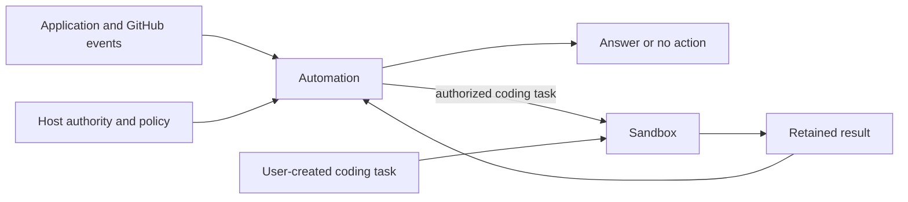

# Automation

Effect libraries for responding to events and running agents in durable workspaces.

| Package                                    | Responsibility                                                                            |
| ------------------------------------------ | ----------------------------------------------------------------------------------------- |
| [@yielded/automation](packages/automation) | Investigate events, reuse decisions, apply host policy and coordinate authorized actions. |
| [@yielded/sandbox](packages/sandbox)       | Prepare repositories, run a chosen agent harness and recover durable workspace execution. |



Automation currently provides software investigation and GitHub repair workflows.
Its investigation, decision and webhook APIs work without Sandbox. Coding and
publication adapters opt into it. Sandbox works independently of Automation;
its Cloudflare implementation lives at `@yielded/sandbox/cloudflare`.

Applications own authentication, tenant and repository authorization, product
records, credentials and provisioned resources. Classification proposes work;
host policy authorizes it. Generated pull requests are proposed changes and are
never automatically merged or deployed.

[@yielded/automation](https://www.npmjs.com/package/@yielded/automation) and
[@yielded/sandbox](https://www.npmjs.com/package/@yielded/sandbox) are available on npm.
See the package READMEs for installation, public imports and composition.

Development installs use workspace links. To try an unreleased Automation change,
Bun consumers can pin the repository to a full Git commit:

```json
{
  "dependencies": {
    "@yielded/automation": "github:yielded-dev/automation#<full-commit-sha>",
    "effect": "^4.1.0"
  },
  "trustedDependencies": ["@yielded/automation"]
}
```

The repository root exposes Automation's public entrypoints and builds its
JavaScript during installation. Its build tools are dependencies of the Git
install only; npm packages contain ready-to-use JavaScript. Sandbox remains a
separate, optional dependency. A Git pin must allow the trusted `prepare` script;
`--ignore-scripts` cannot produce a working Git install.

Try the [standalone coding agent](examples/agent-sandbox): a Yielded Agent calls
a tool to run Sandbox, save a code change and recover its result. It needs no
Automation dependency.

## Development

Use Bun through [Vite+](https://viteplus.dev):

```sh
vp install
vp run check
vp run -F @yielded/automation test:e2e
vp run check:packages
```

`check` checks formatting, lints, typechecks, builds and runs the existing unit tests.
`vp run typecheck` runs Effect-aware tsrs diagnostics with TypeScript checking.
Diagnostic severities are configured in [tsconfig.json](tsconfig.json); errors
fail the command, while warnings remain visible and non-fatal.
`dist` is generated by builds and `prepack`, ignored by Git, and included in npm
packages. `check:packages` installs each package tarball and an Automation Git pin
in separate consumers, runs the native GitHub fixture and bundles the standalone
Sandbox worker. Pass a local container image to also run Sandbox's native Git
history fixture. Native fixtures use real workerd, storage and
alarms; the [native fixture guide](test/README.md) describes their scope and
the additional Docker requirements.

See [package boundaries](docs/architecture.md) for ownership and recovery
contracts, and [AGENTS.md](AGENTS.md) for contribution and review rules.

## Releases

Automation and Sandbox share a stable version. Add a consumer-facing release note
with `vp run changeset`; inspect the planned versions with `vp run changeset status`.
Main updates a `chore: version packages` PR with the versions, changelogs and Bun
lockfile. Merging that PR runs the release checks, publishes through npm trusted
publishing, and creates Git tags and GitHub releases.

To enable the workflow:

1. Install the Yielded release GitHub App with contents and pull-request write
   access, and configure `RELEASES_GH_APP_ID` and `RELEASES_GH_APP_PRIVATE_KEY` as
   repository secrets. App-authored version PRs run the normal checks.
2. Configure each package's
   [npm trusted publisher](https://docs.npmjs.com/trusted-publishers/) for
   `yielded-dev/automation`, workflow `release.yml`, with publishing allowed and
   no environment name. No npm token secret is needed.
3. Set the repository variable `RELEASE_ENABLED=true`.

Use `vp run ci:version` to generate the same version changes locally. Publishing
requires a reviewed version PR; verify npm versions and provenance before retrying
an interrupted release.

MIT licensed. See [LICENSE](LICENSE).
