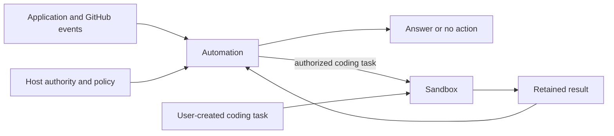

# Automation

Effect libraries for responding to events and running agents in durable workspaces.

| Package                                    | Responsibility                                                                            |
| ------------------------------------------ | ----------------------------------------------------------------------------------------- |
| [@yielded/automation](packages/automation) | Investigate events, reuse decisions, apply host policy and coordinate authorized actions. |
| [@yielded/sandbox](packages/sandbox)       | Prepare repositories, run a chosen agent harness and recover durable workspace execution. |



Automation currently provides software investigation and GitHub repair workflows.
Its investigation, decision and webhook APIs work without Sandbox. Coding and
publication adapters opt into it. Sandbox works independently of Automation;
its Cloudflare implementation lives at `@yielded/sandbox/cloudflare`.

Applications own authentication, tenant and repository authorization, product
records, credentials and provisioned resources. Classification proposes work;
host policy authorizes it. Generated pull requests are proposed changes and are
never automatically merged or deployed.

The packages are being prepared for their first npm release. Development installs
link them as workspaces; see the package READMEs for public imports and composition.

## Development

Use Bun through [Vite+](https://viteplus.dev):

```sh
vp install
vp run check
vp run test:e2e:inspect
vp run check:packages
```

`check` checks formatting, lints, typechecks, builds and runs the existing unit tests.
Compiled package output is committed and verified by CI, so consuming a release
does not require install scripts. `check:packages` installs each package tarball
in a separate consumer, runs the native GitHub fixture and bundles the standalone
Sandbox worker. Pass a local container image to also run Sandbox's native Git
history fixture. Native fixtures use real workerd, storage and
alarms; the [native fixture guide](test/e2e/README.md) describes their scope and
the additional Docker requirements.

See [package boundaries](docs/architecture.md) for ownership and recovery
contracts, and [AGENTS.md](AGENTS.md) for contribution and review rules.

MIT licensed. See [LICENSE](LICENSE).
