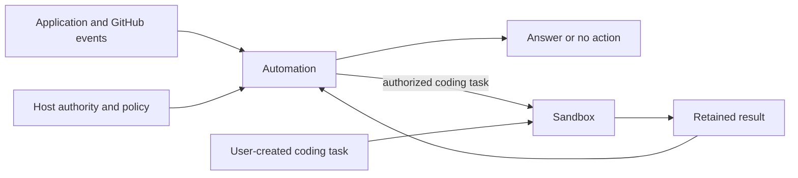

# Automation

Effect libraries for responding to events and running agents in durable workspaces.

| Package                                    | Responsibility                                                                            |
| ------------------------------------------ | ----------------------------------------------------------------------------------------- |
| [@yielded/automation](packages/automation) | Investigate events, reuse decisions, apply host policy and coordinate authorized actions. |
| [@yielded/sandbox](packages/sandbox)       | Prepare repositories, run a chosen agent harness and recover durable workspace execution. |



Automation currently provides software investigation and GitHub repair workflows.
Its investigation, decision and webhook APIs work without Sandbox. Coding and
publication adapters opt into it. Sandbox works independently of Automation;
its Cloudflare implementation lives at `@yielded/sandbox/cloudflare`.

Applications own authentication, tenant and repository authorization, product
records, credentials and provisioned resources. Classification proposes work;
host policy authorizes it. Generated pull requests are proposed changes and are
never automatically merged or deployed.

[@yielded/automation](https://www.npmjs.com/package/@yielded/automation) and
[@yielded/sandbox](https://www.npmjs.com/package/@yielded/sandbox) are available on npm.
See the package READMEs for installation, public imports and composition.

Try the [standalone coding agent](examples/agent-sandbox): a Yielded Agent calls
a tool to run Sandbox, save a code change and recover its result. It needs no
Automation dependency.

## Development

Use Bun through [Vite+](https://viteplus.dev):

```sh
vp install
vp run check
vp run -F @yielded/automation test:e2e
vp run check:packages
```

`check` checks formatting, lints, typechecks, builds and runs the existing unit tests.
`dist` is generated by builds and `prepack`, ignored by Git, and included in npm
packages. Consumers install ready-to-use JavaScript without running build scripts.
`check:packages` installs each package tarball
in a separate consumer, runs the native GitHub fixture and bundles the standalone
Sandbox worker. Pass a local container image to also run Sandbox's native Git
history fixture. Native fixtures use real workerd, storage and
alarms; the [native fixture guide](test/README.md) describes their scope and
the additional Docker requirements.

See [package boundaries](docs/architecture.md) for ownership and recovery
contracts, and [AGENTS.md](AGENTS.md) for contribution and review rules.

## Releases

Once a package exists on npm, configure its
[npm trusted publisher](https://docs.npmjs.com/trusted-publishers/) for GitHub
organization `yielded-dev`, repository `automation`, workflow filename
`release.yml`, with `npm publish` allowed and no environment name. Configure it
near the first authorized release: unused trust expires after two days. No npm
token secret is needed.

Merge the reviewed version change first, then manually dispatch **Release** on
`main`, selecting `sandbox` or `automation` and its exact `expected_version` from
`package.json`. The workflow validates that version, reruns Check's gates, packs
the generated build with Bun and publishes the tarball with npm 12.2.0 and OIDC.
It does not change versions. Verify the published version and provenance on npm
before retrying a failed or interrupted publication.

MIT licensed. See [LICENSE](LICENSE).
